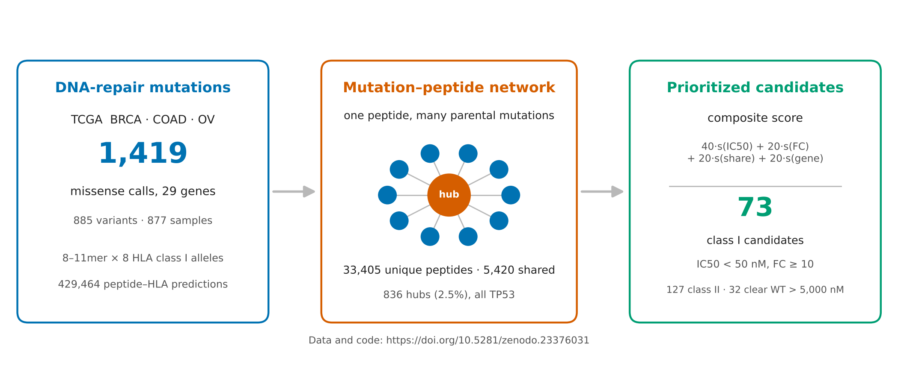
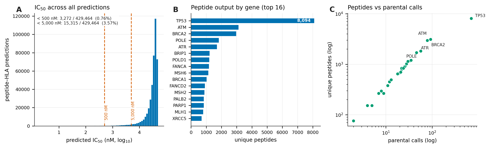
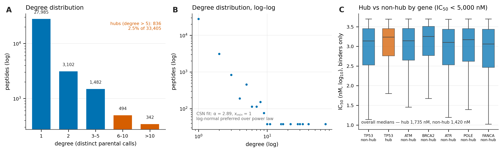
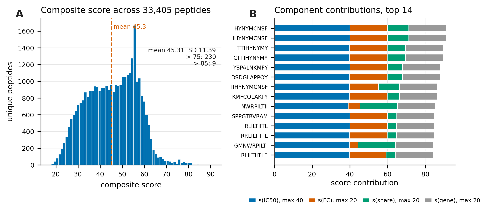
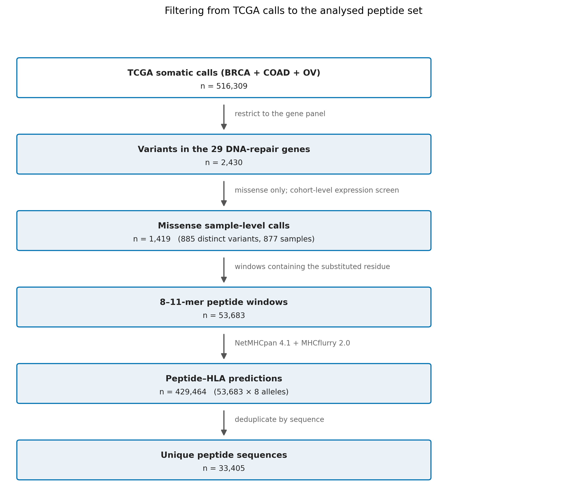
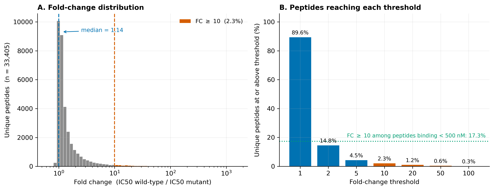
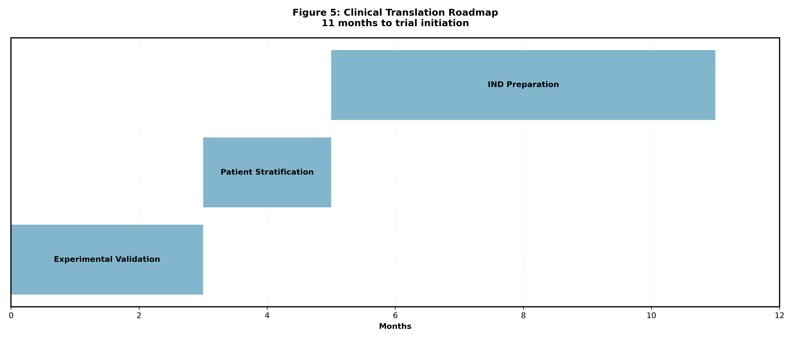

<div align="center">

# Neoepitope Prediction Integrated with DNA Repair Gene Profiling

**Shared missense neoepitopes across 29 DNA-repair genes in TCGA BRCA, COAD and OV**

Pipeline, analysis and figures by **[Shravya R. S.](https://orcid.org/0009-0006-8013-7892)**  
<sub>Department of Biotechnology and Bioinformatics, JSS Academy of Higher Education and Research, Mysuru</sub>

[](https://www.sciencedirect.com/journal/computational-biology-and-chemistry)
[](https://doi.org/10.5281/zenodo.23376031)
[](https://creativecommons.org/licenses/by/4.0/)
[](https://orcid.org/0009-0006-8013-7892)



</div>

---

## What this is

Most neoantigen pipelines rank peptides one patient at a time. This one asks a different question:
**which missense neoepitopes are produced by more than one mutation?**

Peptides shared across mutations sit between a fully personalised vaccine and an off-the-shelf one,
and that redundancy is rarely measured. Here it is measured directly, as a bipartite
mutation–peptide graph over a defined 29-gene DNA-repair set.

Accepted in *Computational Biology and Chemistry* (Elsevier), 28 October 2026.

## Headline numbers

| | |
|---|---|
| Somatic calls screened | 516,309 → 2,430 variants → **1,419** missense calls |
| Distinct variants / samples | 885 variants across 877 tumour samples |
| Peptide windows | **53,683** 8–11mers from 1,417 productive calls |
| Peptide–HLA predictions | **429,464** (8 population HLA class I alleles) |
| Unique mutant peptides | **33,405** |
| Shared by >1 mutation | **5,420** (16.2%) |
| Hub peptides (degree > 5) | **836** (2.5%) — all TP53 |
| Stringent candidates | **73** class I (32 also clear wild-type > 5,000 nM), **127** class II |

Every one of these is reproducible from the deposited data.

## Figures

<table>
<tr>
<td width="50%"></td>
<td width="50%"></td>
</tr>
<tr>
<td><b>1 · The neoepitope landscape.</b> IC50 distribution across all 429,464 peptide–HLA
combinations, unique peptide counts for the most prolific repair genes, and epitope density
per mutation.</td>
<td><b>2 · Network architecture.</b> Mutations per peptide, the hub and super-hub structure,
mutation-pair clustering, and the degree distribution on log–log axes.</td>
</tr>
<tr>
<td></td>
<td></td>
</tr>
<tr>
<td><b>3 · Composite scoring.</b> Score distribution across all 33,405 peptides, the top-ranked
candidates, rank-versus-score behaviour, and component contributions.</td>
<td><b>4 · Filtering.</b> From 516,309 TCGA somatic calls to the analysed peptide set, with the
operation and count at every stage.</td>
</tr>
</table>

<table>
<tr>
<td width="50%"></td>
<td width="50%"></td>
</tr>
<tr>
<td><b>S1 · Fold-change distribution.</b> Mutant preference is widespread but usually slight:
89.6% of peptides exceed a fold change of 1, but only 2.3% reach the conventional 10× threshold.</td>
<td><b>S2 · Translational roadmap.</b> Conceptual only — not supported by data from this study.</td>
</tr>
</table>

## Pipeline

```
TCGA somatic calls (BRCA, COAD, OV)
        │  29 DNA-repair genes, missense only
        ▼
   1,419 sample-level calls  ──►  53,683 peptide windows (8–11mer)
        │
        ▼
NetMHCpan 4.1 + MHCflurry 2.0 (via pVACseq)   ──►  429,464 peptide–HLA predictions
IEDB class II tools (NetMHCIIpan)             ──►  105,495 class II predictions
        │
        ├──► bipartite mutation–peptide graph ──► degree, hubs, super-hubs
        │
        └──► composite score ──► ranked candidates ──► stringent affinity filter
```

## Composite score

```
S = 40·s(IC50) + 20·s(FC) + 20·s(share) + 20·s(gene)

s(IC50)  = 1 − (IC50 − 2)/(49,328 − 2)        linear min–max
s(FC)    = min(fold change, 100)/100           hard cap
s(share) = min(prediction rows, 100)/100       hard cap
s(gene)  = TP53 1.0 · BRCA1/2 0.95 · ATM 0.9 · MSH2/MLH1 0.85 · POLE/ATR 0.8 · others 0.7
```

Two properties worth stating plainly, because they drive the ranking: `s(IC50)` is linear on an
absolute nanomolar scale, so every peptide binding below 500 nM scores 39.60–40.00 of 40 — the
affinity term barely discriminates among binders. And 18.2% of predictions reach the sharing cap
against 0.04% for fold change. **The ranking is therefore driven by sharing and the gene prior
rather than by predicted affinity**, which is reported openly in the paper rather than glossed.

## Repository layout

```
code/      analysis and verification scripts
figures/   figures as published
docs/      reproduction notes and environment
```

## Data

All inputs and outputs live in the Zenodo deposit, not here — the prediction tables run to
hundreds of megabytes:

**https://doi.org/10.5281/zenodo.23376031**

Thirty files: the mutation list, the full class I and class II prediction tables, the
mutation–peptide edge list, network degrees, the composite-score components, nine supplementary
tables, the pipeline code, and a pinned environment specification. CC-BY-4.0.

## Reproducing

```bash
pip install -r requirements.txt
```

See [`docs/REPRODUCE.md`](docs/REPRODUCE.md) for the execution order. External predictors
(NetMHCpan 4.1, MHCflurry 2.0, NetMHCIIpan) are not redistributable, but their outputs are
deposited, so every downstream step can be rerun without them.

## Citation

The paper is accepted in *Computational Biology and Chemistry* (Elsevier) and is in production.
Its DOI will be added here once it is published.

Until then, please cite the dataset:

**[10.5281/zenodo.23376031](https://doi.org/10.5281/zenodo.23376031)**

Formatted citations and the full author list are available at that link.

## Credits

Pipeline design, implementation, analysis and manuscript — **Shravya R. S.**
([@ShravyaRS](https://github.com/ShravyaRS) · [ORCID](https://orcid.org/0009-0006-8013-7892)),
Department of Biotechnology and Bioinformatics, JSS Academy of Higher Education and Research, Mysuru.

Study supervision — Prof. Tiratha Raj Singh, CEHTI, Jaypee University of Information Technology.

Somatic variant and expression data from [TCGA](https://portal.gdc.cancer.gov) via the Genomic Data Commons.

## License

Code and documentation: CC-BY-4.0, matching the Zenodo deposit. Please cite the paper and the dataset.
